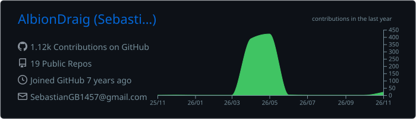
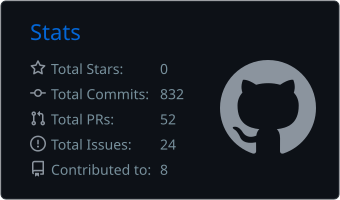

  

  I build Python automation and backend services that remove manual work, integrating LLMs into real document and data workflows, shipped with Docker and CI/CD.

  
  
  
  

---

## About me

- **Python first** — backend APIs (FastAPI), automation pipelines and integrations between APIs, databases and services.
- **Applied AI** — I plug existing LLMs (Groq, AWS Bedrock, OpenAI-compatible) into document generation and data analysis, always with a deterministic fallback.
- **RPA** — Automation Anywhere 360 development and tooling that documents and audits bots automatically.
- **Ship it properly** — Docker / Docker Compose, GitHub Actions with test-coverage gates, security scanning and CodeQL. Currently deepening AWS.

**Open to:** Automation Engineer · AI Integration Engineer · Backend Engineer — remote, from Colombia.

## Featured projects

| Project | What it is | Built with | Highlights |
|---|---|---|---|
| [**AtlasFinance**](https://github.com/AlbionDraig/AtlasFinance) | Full-stack personal finance platform: accounts, pockets, transactions, budgets, savings goals and investments | FastAPI · SQLAlchemy 2 · PostgreSQL · React 19 · TypeScript · Docker Compose | ~190 backend tests with a 92% coverage gate, Vitest + Playwright E2E, 5 CI workflows (tests, lint/type-check, Bandit/pip-audit, CodeQL), JWT with token revocation |
| [**RPA Doc Generator**](https://github.com/AlbionDraig/rpa-doc-generator) | API that turns an Automation Anywhere 360 export into a Software Design Document and a code-quality report (MD / DOCX / PDF + flow diagram) | Python · FastAPI · Groq / AWS Bedrock / OpenAI-compatible · python-docx | Pluggable LLM provider router with heuristic fallback, 100+ tests with a 90% coverage gate, ZIP-bomb and rate-limit hardening |
| [**CoreForge**](https://github.com/AlbionDraig/UtilitiesPC) | Windows desktop app that applies performance profiles (gaming, work, dev): closes/opens apps, switches power plans, stops WSL | Tauri 2 · Rust · React 19 · TypeScript | Native Rust services behind typed IPC commands, ES/EN i18n with parity tests, CI for frontend and Rust |
| [**Homelab**](https://github.com/AlbionDraig/homelab-ubuntu-server) | My Ubuntu Server homelab as code: reverse proxy, observability and security stacks | Docker Compose · Traefik · Prometheus · Grafana · Loki · CrowdSec · Bash | 11 Compose stacks, 4 provisioned Grafana dashboards, cron-driven ops scripts (health checks, backups with restore verification, security audit), CI validation |

**QA & test automation** — [Ghost CMS test suite](https://github.com/AlbionDraig/Pruebas_Automatizadas_Software_Ghost) (team course project: Cypress & Kraken E2E, BackstopJS/Resemble visual regression, Faker data strategies) · [WebdriverIO + Cucumber](https://github.com/AlbionDraig/CucumberWebdriverio) · [Screenplay pattern in Python](https://github.com/AlbionDraig/PyScreenPlay)

## Tech stack

  

  
  
  

## GitHub stats

  

  
  

---

<b>🇪🇸 Versión en español</b>

 

Construyo automatizaciones y servicios backend en Python que eliminan trabajo manual, integrando modelos de IA en flujos reales de documentación y análisis de datos, con Docker y CI/CD.

**Sobre mí**

- **Python como base**: APIs backend (FastAPI), pipelines de automatización e integraciones entre APIs, bases de datos y servicios.
- **IA aplicada**: integro LLMs existentes (Groq, AWS Bedrock, compatibles con OpenAI) en generación de documentación y análisis de datos, siempre con un plan B determinista.
- **RPA**: desarrollo en Automation Anywhere 360 y herramientas que documentan y auditan bots automáticamente.
- **Entrega con calidad**: Docker / Docker Compose, GitHub Actions con umbrales de cobertura, escaneo de seguridad y CodeQL. Actualmente profundizando en AWS.

**Disponible para:** Automation Engineer · AI Integration Engineer · Backend Engineer, en remoto desde Colombia.

**Proyectos destacados**

- [**AtlasFinance**](https://github.com/AlbionDraig/AtlasFinance): plataforma full-stack de finanzas personales (FastAPI + PostgreSQL + React 19/TypeScript), con ~190 tests de backend, cobertura mínima del 92% y 5 workflows de CI.
- [**RPA Doc Generator**](https://github.com/AlbionDraig/rpa-doc-generator): API que genera el documento de diseño (SDD) y el reporte de calidad de bots de Automation Anywhere 360, con análisis opcional por IA.
- [**CoreForge**](https://github.com/AlbionDraig/UtilitiesPC): app de escritorio Tauri 2 + Rust + React que aplica perfiles de rendimiento en Windows.
- [**Homelab**](https://github.com/AlbionDraig/homelab-ubuntu-server): mi servidor Ubuntu como código, con 11 stacks de Docker Compose, observabilidad con Prometheus/Grafana/Loki y scripts de operación automatizados.
- **QA**: [suite de pruebas de Ghost CMS](https://github.com/AlbionDraig/Pruebas_Automatizadas_Software_Ghost) (proyecto de curso en equipo), [WebdriverIO + Cucumber](https://github.com/AlbionDraig/CucumberWebdriverio) y [patrón Screenplay en Python](https://github.com/AlbionDraig/PyScreenPlay).

---

  <i>"I don't just write code — I build systems that create operational leverage."</i>

  

