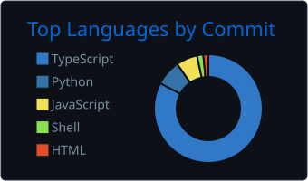

  

  Software engineer with 4+ years building backend services, process automation and cloud-native data solutions for banking, logistics and finance — with Python, AI and CI/CD.

  
  
  
  

---

## About me

- **Backend & APIs** — Python (FastAPI, Django, Flask), REST APIs with JWT auth, SQL Server and PostgreSQL.
- **Data engineering** — ETL pipelines with PySpark, Pandas and Docker, integrating data across enterprise systems and DEV / QA / PROD environments.
- **Applied AI** — LLMs (Groq, AWS Bedrock, OpenAI-compatible) wired into document generation, quality analysis and invoice processing, always with a deterministic fallback.
- **Cloud & delivery** — AWS and Azure, Docker, GitHub Actions and Jenkins, multi-stage CI/CD, Agile (Scrum / Kanban).

**Open to:** Solution Engineer · Backend Engineer · Automation / AI Engineer — remote, from Colombia.

## Experience highlights

- **Tech lead** for a team of up to 3 developers, owning delivery and SLAs on automation projects.
- **Data pipelines** in Python, PySpark and Docker processing **65 GB+ per day**, saving up to **USD 10K/month** by replacing AWS Glue.
- **Internal tooling** — designed a Python tool that automates design documentation and quality checks for automation bots, adopted as the standard by every team in the account.
- **Engineering standards** — deployment manuals, reusable SQL snippets and documentation that reduced rework and onboarding time across teams.

## Featured projects

| Project | What it is | Built with | Highlights |
|---|---|---|---|
| [**AtlasFinance**](https://github.com/AlbionDraig/AtlasFinance) | Full-stack personal finance platform: accounts, pockets, transactions, budgets, savings goals and investments | FastAPI · SQLAlchemy 2 · PostgreSQL · React 19 · TypeScript · Docker Compose | ~190 backend tests with a 92% coverage gate, Vitest + Playwright E2E, 5 CI workflows (tests, lint/type-check, Bandit/pip-audit, CodeQL), JWT with token revocation |
| [**RPA Doc Generator**](https://github.com/AlbionDraig/rpa-doc-generator) | API that turns RPA bot exports into a Software Design Document and a code-quality report (MD / DOCX / PDF + flow diagram) | Python · FastAPI · Groq / AWS Bedrock / OpenAI-compatible · python-docx | Pluggable LLM provider router with heuristic fallback, 100+ tests with a 90% coverage gate, ZIP-bomb and rate-limit hardening |
| [**CoreForge**](https://github.com/AlbionDraig/UtilitiesPC) | Windows desktop app that applies performance profiles (gaming, work, dev): closes/opens apps, switches power plans, stops WSL | Tauri 2 · Rust · React 19 · TypeScript | Native Rust services behind typed IPC commands, ES/EN i18n with parity tests, CI for frontend and Rust |
| [**Homelab**](https://github.com/AlbionDraig/homelab-ubuntu-server) | My Ubuntu Server homelab as code: reverse proxy, observability and security stacks | Docker Compose · Traefik · Prometheus · Grafana · Loki · CrowdSec · Bash | 11 Compose stacks, 4 provisioned Grafana dashboards, cron-driven ops scripts (health checks, backups with restore verification, security audit), CI validation |

**QA & test automation** — [Ghost CMS test suite](https://github.com/AlbionDraig/Pruebas_Automatizadas_Software_Ghost) (team course project: Cypress & Kraken E2E, BackstopJS/Resemble visual regression, Faker data strategies) · [WebdriverIO + Cucumber](https://github.com/AlbionDraig/CucumberWebdriverio) · [Screenplay pattern in Python](https://github.com/AlbionDraig/PyScreenPlay)

## Tech stack

  

  
  
  
  

## GitHub stats

  

  
  

---

<b>🇪🇸 Versión en español</b>

 

Ingeniero de software con más de 4 años de experiencia en desarrollo backend, automatización de procesos y soluciones de datos cloud-native para banca, logística y finanzas, con Python, IA y CI/CD.

**Sobre mí**

- **Backend y APIs**: Python (FastAPI, Django, Flask), APIs REST con autenticación JWT, SQL Server y PostgreSQL.
- **Ingeniería de datos**: pipelines ETL con PySpark, Pandas y Docker, integrando datos entre sistemas empresariales y ambientes DEV / QA / PROD.
- **IA aplicada**: LLMs (Groq, AWS Bedrock, compatibles con OpenAI) integrados en generación documental, análisis de calidad y procesamiento de facturas, siempre con un plan B determinista.
- **Cloud y entrega**: AWS y Azure, Docker, GitHub Actions y Jenkins, CI/CD multi-stage, metodologías ágiles (Scrum / Kanban).

**Disponible para:** Solution Engineer · Backend Engineer · Automation / AI Engineer, en remoto desde Colombia.

**Logros destacados**

- **Liderazgo técnico** de un equipo de hasta 3 desarrolladores, a cargo de la entrega y los SLA de proyectos de automatización.
- **Pipelines de datos** en Python, PySpark y Docker que procesan **más de 65 GB diarios**, con ahorros de hasta **USD 10K/mes** al reemplazar AWS Glue.
- **Herramientas internas**: diseñé una herramienta en Python que automatiza la documentación de diseño y la validación de calidad de bots de automatización, adoptada como estándar por todos los equipos de la cuenta.
- **Estándares de ingeniería**: manuales de despliegue, snippets SQL reutilizables y documentación que redujeron reprocesos y tiempos de onboarding.

**Proyectos destacados**

- [**AtlasFinance**](https://github.com/AlbionDraig/AtlasFinance): plataforma full-stack de finanzas personales (FastAPI + PostgreSQL + React 19/TypeScript), con ~190 tests de backend, cobertura mínima del 92% y 5 workflows de CI.
- [**RPA Doc Generator**](https://github.com/AlbionDraig/rpa-doc-generator): API que genera el documento de diseño (SDD) y el reporte de calidad de bots RPA, con análisis opcional por IA.
- [**CoreForge**](https://github.com/AlbionDraig/UtilitiesPC): app de escritorio Tauri 2 + Rust + React que aplica perfiles de rendimiento en Windows.
- [**Homelab**](https://github.com/AlbionDraig/homelab-ubuntu-server): mi servidor Ubuntu como código, con 11 stacks de Docker Compose, observabilidad con Prometheus/Grafana/Loki y scripts de operación automatizados.
- **QA**: [suite de pruebas de Ghost CMS](https://github.com/AlbionDraig/Pruebas_Automatizadas_Software_Ghost) (proyecto de curso en equipo), [WebdriverIO + Cucumber](https://github.com/AlbionDraig/CucumberWebdriverio) y [patrón Screenplay en Python](https://github.com/AlbionDraig/PyScreenPlay).

---

  <i>"I don't just write code — I build systems that create operational leverage."</i>

  

